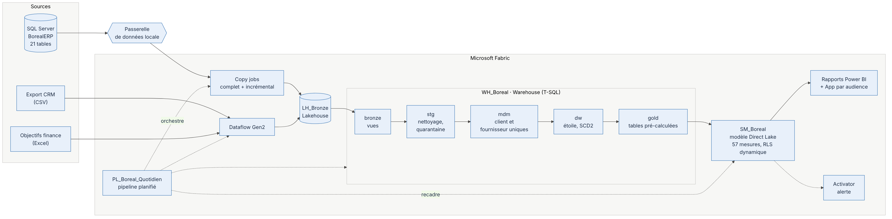
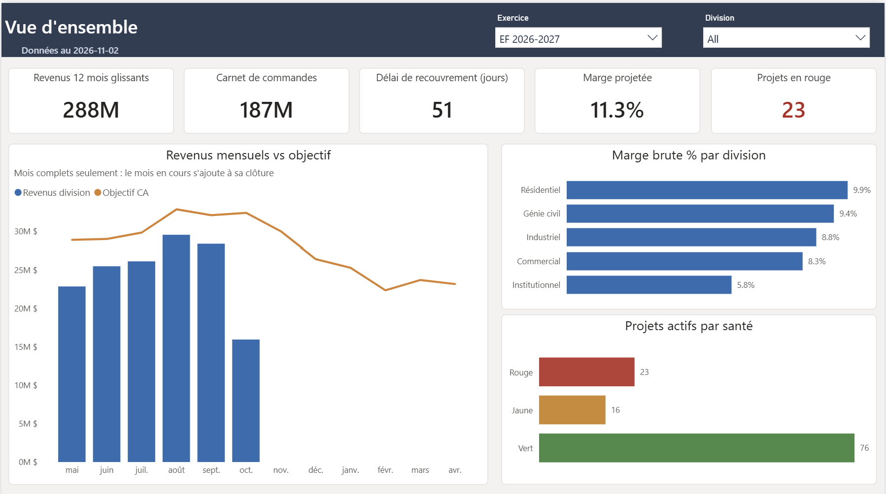
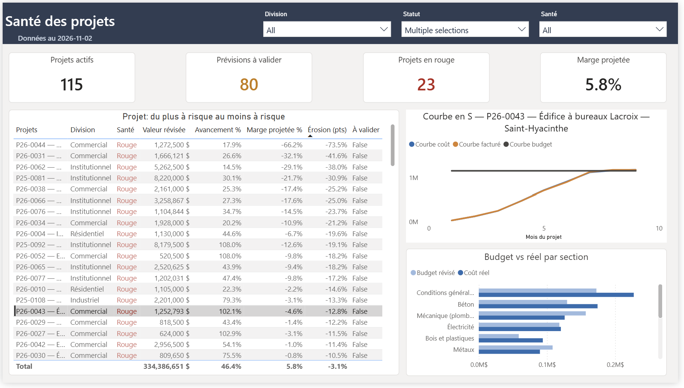
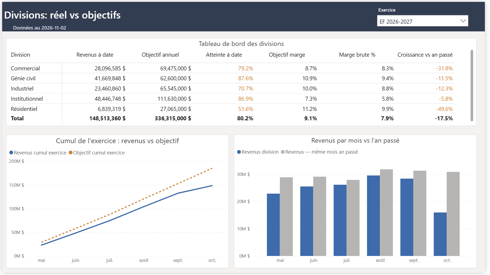
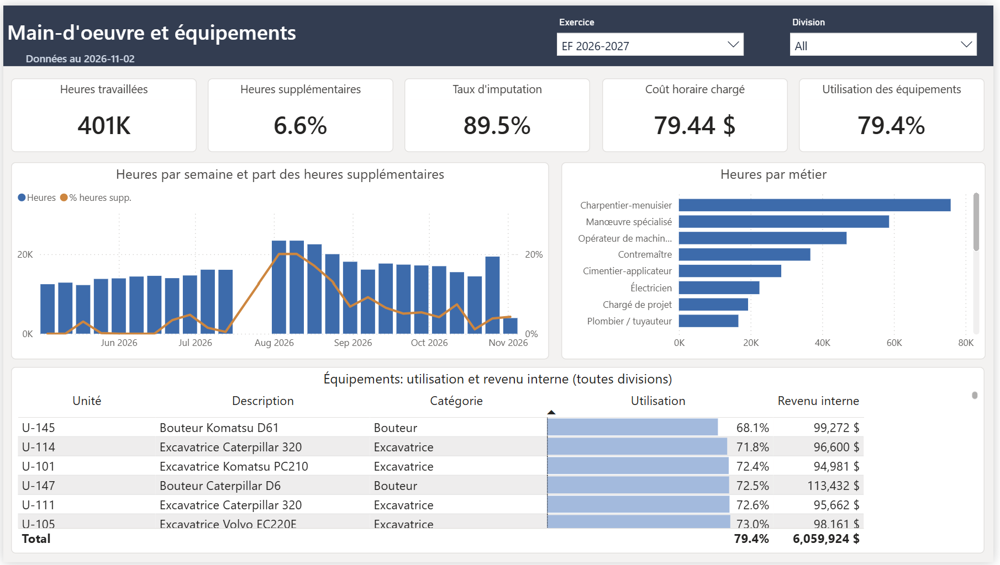
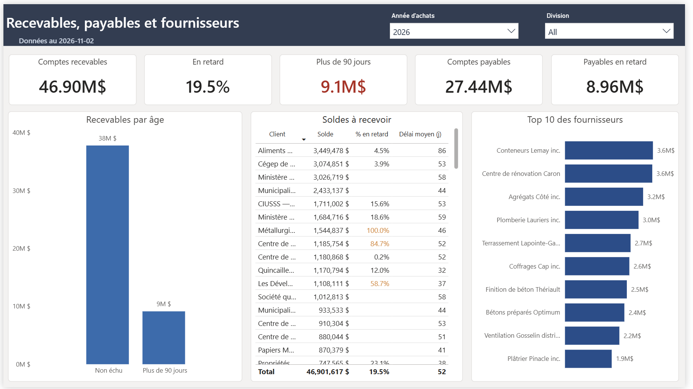
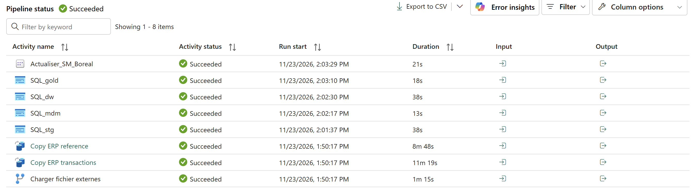
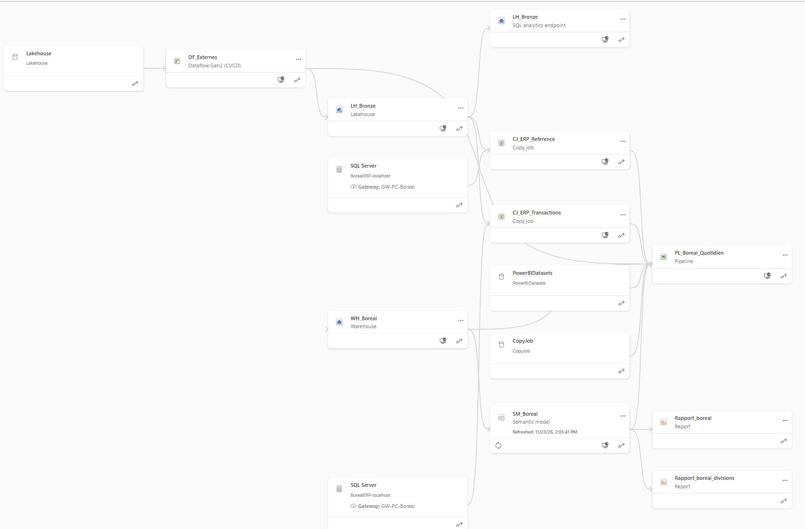
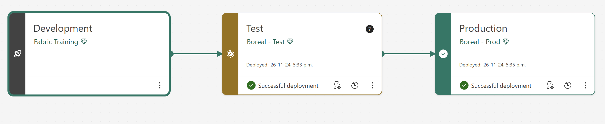
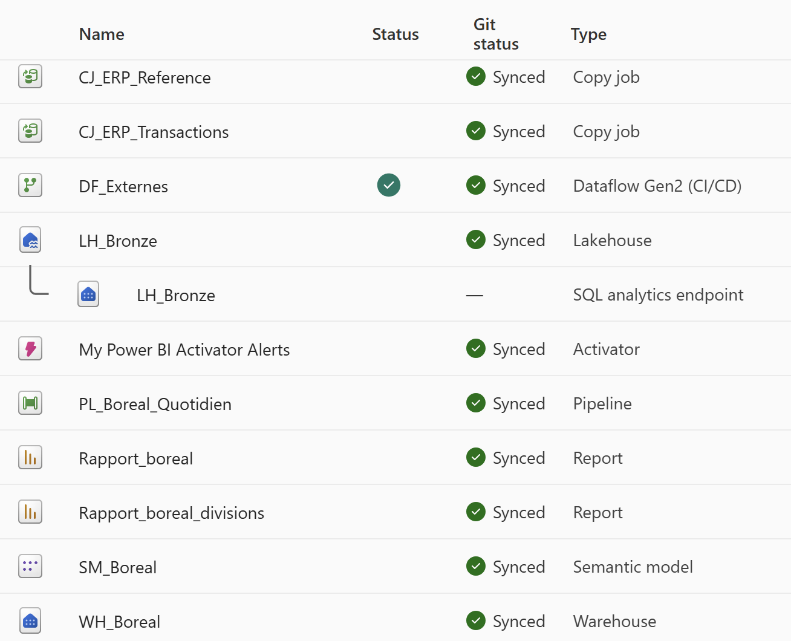

# Construction Boréal: plateforme analytique de bout en bout sur Microsoft Fabric

*[English summary below](#english-summary)*

Un entrepreneur général québécois veut suivre la rentabilité de ses projets, l'atteinte des objectifs de ses divisions et ses comptes clients et fournisseurs. Ce projet construit toute la chaîne : de la base de données de l'ERP jusqu'à une App Power BI mise à jour automatiquement chaque nuit, avec une sécurité par division.

> **Construction Boréal inc. est une entreprise fictive.** Les données (environ 1,47 million de lignes, 2019 à 2026) sont générées par le script `generateur/gen.py`, avec des défauts de qualité volontaires : doublons, codes manquants, versions multiples, formats régionaux. Les détecter et les corriger fait partie du projet.



## En bref

| Élément | Détail |
|---|---|
| **Source** | SQL Server sur site (ERP, 21 tables), un export CRM en CSV, un fichier Excel d'objectifs |
| **Ingestion** | Passerelle de données locale, Copy jobs (complet et incrémental par filigrane), Dataflow Gen2 |
| **Stockage** | OneLake : lakehouse bronze (Delta) et entrepôt Fabric |
| **Transformation** | T-SQL en couches : bronze → staging → master data → étoile → gold |
| **Modèle** | Modèle sémantique **Direct Lake**, 22 relations, 57 mesures DAX, **RLS dynamique** |
| **Restitution** | 2 rapports Power BI (5 pages et 3 pages), une App avec deux audiences, une alerte Activator |
| **Automatisation** | Pipeline Fabric quotidien, journal d'audit par exécution, test de bout en bout réussi |
| **Cycle de vie** | Pipeline de déploiement Dév → Test → Prod, intégration Git (TMDL, PBIR) |

## Ce que fait chaque couche

| Couche | Rôle | Techniques |
|---|---|---|
| **Bronze** (lakehouse) | Copie fidèle de la source, avec l'historique des versions | Copy job incrémental sur `ModifiedAt`, mode Append |
| **Vues bronze** | Fenêtre sur le lakehouse sans copie ; isole les noms de la source | Requêtes entre bases (lakehouse → entrepôt) |
| **Staging** | Données fiables : dernière version, types précis, quarantaine avec la raison du rejet | `ROW_NUMBER`, CTAS, tables de rejets |
| **Master data** | Un seul client et un seul fournisseur malgré deux sources (ERP et CRM) | Appariement par NEQ puis par nom normalisé, table de correspondance (`MERGE`), règles de survie |
| **DW** | Schéma en étoile : 11 tables de faits, dimensions conformes | Membre « inconnu » (-1), SCD de type 2 sur les employés, `TRUNCATE` + `INSERT` |
| **Gold** | Une table pré-calculée par question des visuels | Cumuls d'exercice, même mois l'an passé, âge des comptes, santé des projets, analyse ABC |
| **Modèle Direct Lake** | Lit les tables gold dans OneLake sans les copier | Mesures `DIVIDE(SUM, SUM)`, dossiers d'affichage, identité fixe, RLS par `USERPRINCIPALNAME()` |

## Le rapport

| Page | Public | Question |
|---|---|---|
| Vue d'ensemble | Direction | Comment va l'entreprise ? |
| Santé des projets | Directeurs, chargés de projets | Quels projets sont en danger, et pourquoi ? |
| Divisions | Direction, directeurs | Chaque division atteint-elle ses objectifs ? |
| Main-d'œuvre et équipements | Opérations | Utilise-t-on bien nos gens et nos machines ? |
| Recevables, payables et fournisseurs | Contrôleuse | Qui nous doit de l'argent, et à qui en devons-nous ? |




<details>
<summary>Autres captures : divisions, main-d'œuvre, comptes, pipeline, lignage</summary>







</details>

## Décisions et problèmes résolus

Ce que le projet m'a appris se trouve surtout ici : un chiffre juste en SQL peut être faux pour l'entreprise.

| Problème constaté | Diagnostic | Solution |
|---|---|---|
| Marge brute des divisions entre -2 % et +2 %, alors que la marge projetée est de 11 % | Le mois en cours a ses coûts (saisis chaque jour) sans sa facturation (en fin de mois) | Colonne `est_mois_complet` calculée en SQL à chaque chargement ; les mesures ne retiennent que les mois complets, sans filtre manuel |
| 43 % des projets « en rouge » | Le % d'avancement saisi (fin de mois) était comparé à des coûts quotidiens | Règle de coût projeté révisée et indicateur `prevision_a_valider` pour les projets à confirmer par le chargé de projet |
| Revenus mensuels apparemment au-dessus de l'objectif | Deux montants en $ sur deux axes Y d'échelles différentes | Un seul axe pour une même unité ; le double axe est réservé aux unités différentes (heures et %) |
| « Test as role » refusé sur le modèle | Direct Lake en SSO ne permet pas d'emprunter une autre identité | Identité fixe pour la lecture ; filtre RLS validé en DAX avec `TREATAS`, puis test avec un compte Viewer |
| Rapport vide pendant quelques minutes à chaque chargement | La mise à jour automatique de Direct Lake se déclenchait entre `TRUNCATE` et `INSERT` | Mise à jour automatique désactivée ; recadrage du modèle en dernière activité du pipeline |
| Trou de deux semaines dans les heures de fin juillet | Vacances de la construction au Québec, pas une erreur | Expliqué dans le rapport plutôt que « corrigé » |
| Activité du pipeline bloquée en « In progress » | Le journal d'audit montrait toutes les couches terminées en 2 minutes | L'écran n'était pas actualisé : vérifier à la source avant d'annuler |
| 45 factures fournisseurs en double (642 580 \$), 2 130 lignes sans code de coût (12,3 M\$) | Tests de qualité (`17_tests_qualite.sql`) | Doublons marqués en staging (`est_doublon`) et exclus des coûts ; lignes sans code rattachées au membre « inconnu » (-1) pour ne perdre aucun montant |

## Sécurité

- **RLS dynamique** : une table `dw.securite_division` (UPN, division) et un seul rôle. Un directeur ne voit que sa division sur toutes les pages ; une personne absente de la table ne voit rien.
- **App par audience** : la direction voit le rapport complet, les directeurs de division un rapport de 3 pages. L'audience range le contenu ; c'est le RLS qui protège les données.
- **Moindre privilège** : compte SQL en lecture seule pour la passerelle, aucune donnée sensible ni mot de passe dans ce dépôt.

## Cycle de vie : Dév → Test → Prod et contrôle de version



| Environnement | Rôle |
|---|---|
| **Dév** | Construction des éléments ; espace relié à Git |
| **Test** | Validation des chiffres par le métier avant la mise en production |
| **Prod** | Source de l'App : seule version vue par les utilisateurs |

**Ce qui a été fait**
- Pipeline de déploiement Fabric à trois étapes : le modèle sémantique et les deux rapports sont promus de Dév à Test, puis à Prod ; l'App est publiée depuis Prod.
- Les connexions ne sont pas copiées par le déploiement : dans chaque environnement, le modèle est lié à une connexion cloud à identité fixe (SSO désactivé). Les lecteurs n'ont besoin d'aucun accès à l'entrepôt, et la sécurité au niveau des lignes s'applique.
- L'espace de Dév est relié à un dépôt GitHub **privé** (intégration Git de Fabric) : modèle en TMDL, rapports en PBIR, entrepôt, lakehouse et pipeline. Chaque changement devient un commit lisible (par exemple, une seule ligne modifiée dans le `visual.json` d'un visuel), puis il est promu de Test à Prod.
- Le pipeline quotidien recadre les trois modèles (Dév, Test et Prod) **après** la fin du chargement, avec la mise à jour automatique de Direct Lake désactivée partout. Ainsi, les utilisateurs ne voient jamais de tables vides pendant le `TRUNCATE`/`INSERT`.



**Choix de ce projet et pratique complète en entreprise**
- Seule la couche BI est déployée : Test et Prod lisent l'entrepôt de Dév (une seule capacité d'essai). En entreprise, chaque environnement a sa propre chaîne (lakehouse, entrepôt, pipeline), et des règles de déploiement pointent chaque modèle vers l'entrepôt de son environnement.
- Commits directs sur `main` (développeur seul). En entreprise : branche par fonctionnalité, Pull Request approuvée par un pair, branche `main` protégée, et souvent un espace de travail par branche.
- Le dépôt relié à Fabric est privé, car les définitions contiennent des adresses de serveurs et de connexions. Ce dépôt public présente le code SQL et DAX.
- La passerelle de données est installée sur le poste du développeur, donc le pipeline est lancé manuellement. En entreprise, elle tourne sur un serveur dédié (souvent deux, en grappe), et le pipeline est planifié chaque nuit.

## Automatisation

Le pipeline `PL_Boreal_Quotidien` lance les trois chargements bronze en parallèle, puis les couches SQL en série (staging → MDM → DW → gold), puis recadre les modèles Direct Lake de Dév, Test et Prod.. Chaque procédure reçoit le `RunId` du pipeline et écrit dans `audit.journal_execution`.

**Test de bout en bout** : 10 jours d'activité simulés dans l'ERP (`03_simulation_quotidienne.sql`), une exécution du pipeline, et l'App est passée des données du 23 octobre à celles du 2 novembre 2026, avec octobre devenu un mois complet, sans aucune intervention manuelle.

## Reproduire le projet

1. Générer les données : `pip install -r generateur/requirements.txt`, puis `python generateur/gen.py .` (crée `source_sqlserver/donnees/`).
2. SQL Server : exécuter `sql/1_source_sqlserver/01`, `02` et `04` (remplacer les mots de passe entre `< >`).
3. Fabric : installer la passerelle, créer le lakehouse `LH_Bronze`, les Copy jobs et le Dataflow Gen2.
4. Entrepôt `WH_Boreal` : exécuter `sql/2_fabric_warehouse/10` à `18`, puis `EXEC audit.usp_executer_chargement_complet;`.
5. Modèle Direct Lake sur les tables gold, puis les mesures de `power_bi/definir_mesures_SM_Boreal.dax` et `power_bi/correctif_mois_complet.dax` (vue requête DAX).

## Structure du dépôt

```
├── sql/
│   ├── 1_source_sqlserver/   # base ERP, chargement, simulation, comptes
│   └── 2_fabric_warehouse/   # bronze, staging, MDM, DW, gold, orchestration, tests
├── power_bi/                 # mesures DAX et correctifs
├── generateur/               # générateur Python des données fictives
├── fichiers_externes/        # export CRM et objectifs (Excel)
└── docs/                     # architecture et captures
```

## Compétences démontrées

Microsoft Fabric (lakehouse, entrepôt, Copy job, Dataflow Gen2, pipeline, Activator) · T-SQL avancé (fonctions de fenêtrage, `MERGE`, CTAS, gestion d'erreurs) · modélisation dimensionnelle et SCD 2 · gestion des données de référence · Power BI (Direct Lake, DAX, RLS dynamique, App) · qualité des données · orchestration et journal d'audit · pipeline de déploiement et contrôle de version (intégration Git).

## Défis et apprentissages

- Connecter un SQL Server local à Fabric : configuration de la passerelle de données
- Choisir entre chargement complet et incrémental selon le type de table
- Garantir la qualité des données entre les couches bronze, staging et gold
- Mettre en place la sécurité au niveau des lignes dans un modèle Direct Lake

## Auteur

**Jordy Romaric Simo** · Analyste de données BI, Montréal · Certifié Microsoft PL-300 (Power BI Data Analyst)
[LinkedIn](https://www.linkedin.com/in/jordy-simo)

---

## English summary

**End-to-end analytics platform on Microsoft Fabric for a fictional Quebec general contractor.** On-premises SQL Server ERP data (≈1.47 M rows) is ingested through an on-premises data gateway with full and incremental (watermark) Copy jobs, plus a Dataflow Gen2 for CRM and Excel files, into a bronze lakehouse. A Fabric warehouse transforms it in T-SQL layers (bronze views → staging with quarantine → master data management → star schema with SCD2 → pre-aggregated gold tables). A **Direct Lake** semantic model (57 DAX measures, **dynamic row-level security** with `USERPRINCIPALNAME()`) feeds two Power BI reports published as an App with two audiences, plus an Activator alert. A nightly Fabric pipeline orchestrates everything, logs each run with its `RunId`, and reframes the Direct Lake models (Dev, Test, Prod) only once the gold layer is complete.

The key lessons are in the **problems solved** table above: an incomplete current month crushing margins (fixed upstream with an `est_mois_complet` flag), a misleading dual axis, Direct Lake "Test as role" blocked under SSO, and refresh timing issues during truncate-and-load. The company and data are fictional and generated by `generateur/gen.py`.

**Lifecycle:** a three-stage Fabric deployment pipeline promotes the semantic model and reports from Dev to Test to Prod, and the App is published from Prod. The Dev workspace is connected to a private GitHub repository through Fabric Git integration (TMDL and PBIR), so each change is a readable commit before promotion.

**Author:** Jordy Romaric Simo · BI data analyst, Montréal · Microsoft Certified PL-300 · [LinkedIn](https://www.linkedin.com/in/jordy-simo)
